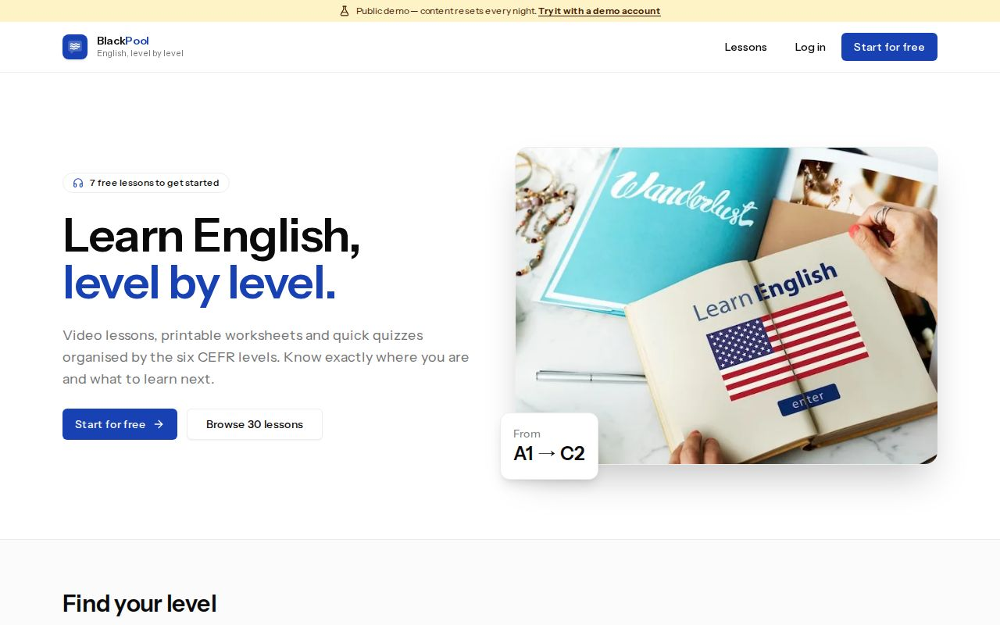
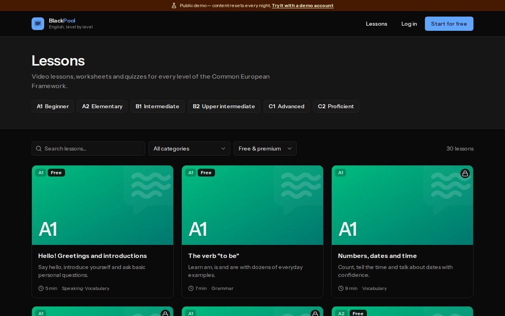
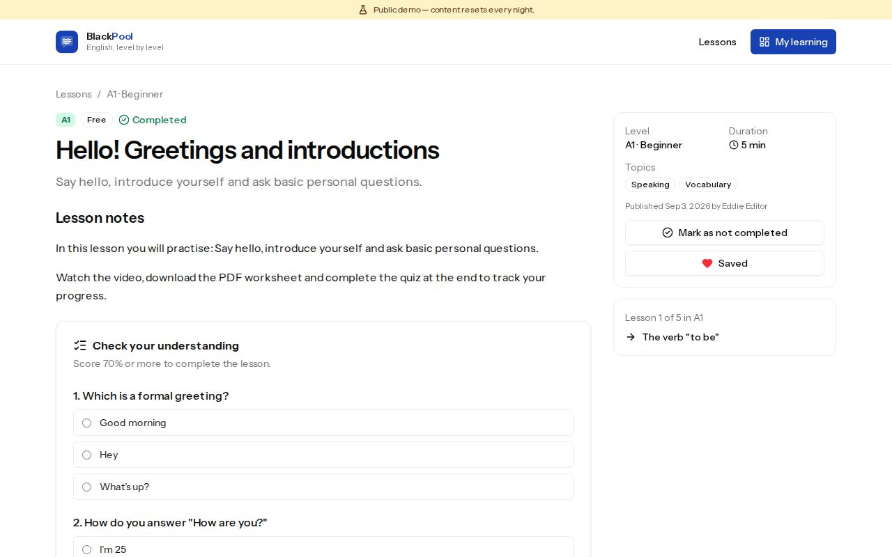
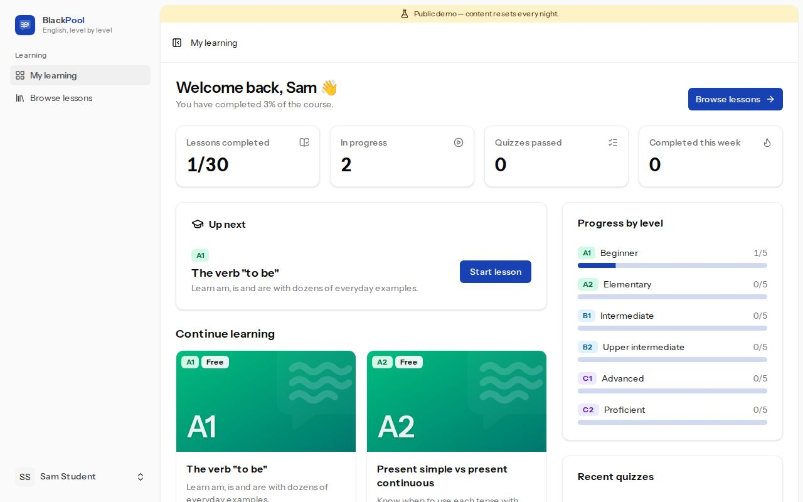
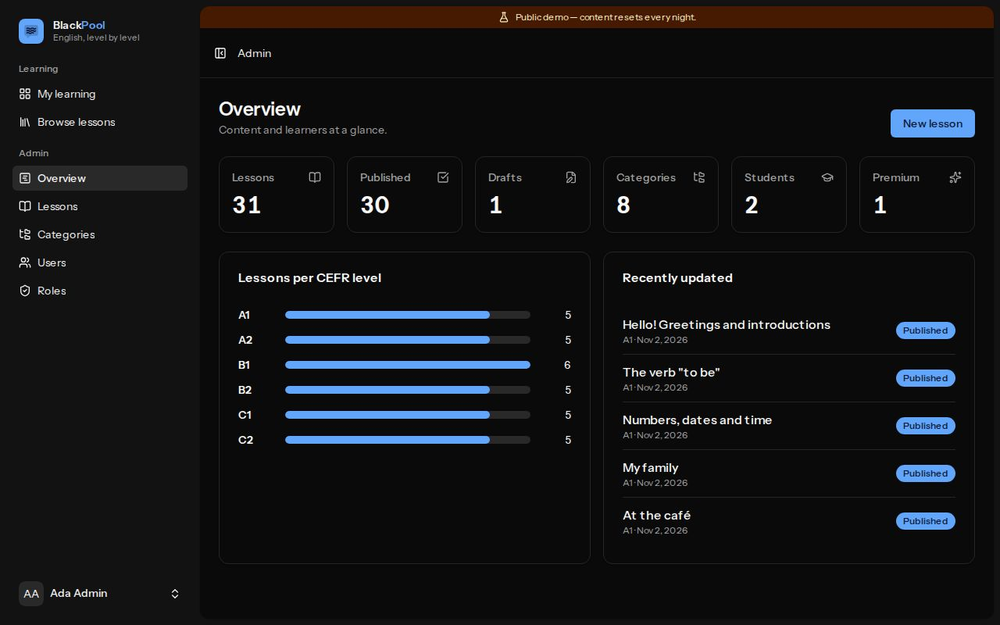
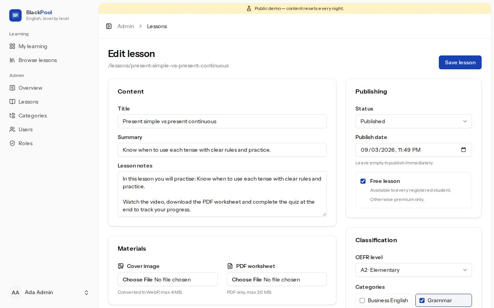
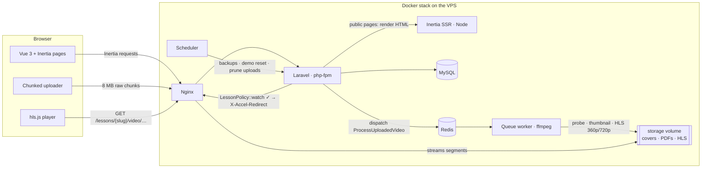

<p align="center">
  
</p>

<h1 align="center">BlackPool</h1>

<p align="center">
  <strong>An English-learning platform organised by CEFR level (A1 → C2).</strong><br>
  Video lessons with adaptive streaming, PDF worksheets, quizzes, progress tracking and a full admin backoffice.
</p>

<p align="center">
  
  
  
  
  
  
</p>

> 🇪🇸 **Resumen:** BlackPool es una plataforma para aprender inglés por niveles del MCER. Los alumnos ven vídeos en streaming adaptativo (HLS), descargan fichas en PDF, hacen quizzes y siguen su progreso. Los editores gestionan el contenido desde un backoffice con subida de vídeo por trozos y transcodificación con ffmpeg en cola. Está construida con Laravel 13, Inertia 3, Vue 3 + TypeScript, se prueba con Pest, Vitest y Playwright, y se despliega con Docker en un VPS detrás de Cloudflare. Solo usa herramientas gratuitas y open source.

---

## Screenshots

| Landing                                                                    | Catalogue                                                      |
| -------------------------------------------------------------------------- | -------------------------------------------------------------- |
|                            |    |
| **Lesson with quiz**                                                       | **Student dashboard**                                          |
|                           |  |
| **Admin overview**                                                         | **Lesson editor (video + quiz)**                               |
|  |  |

## Features

**For students**

- Public catalogue filterable by CEFR level, category, free/premium and full-text search.
- Lesson page with an **HLS player** (hls.js, resume where you left off) or a privacy-friendly YouTube/Vimeo embed.
- Private **PDF worksheets**, **multiple-choice quizzes** (passing with 70% completes the lesson), favourites, and previous/next navigation.
- **"My learning" dashboard**: progress per level, up next, in progress, saved lessons and quiz history.

**For editors and admins**

- Lesson editor with draft/published workflow, scheduling, cover images (auto-converted to WebP) and PDFs.
- **Chunked, resumable video uploads**, sized under Cloudflare's 100 MB request limit. A queued **ffmpeg** job generates 360p/720p adaptive HLS and a thumbnail; the editor polls the status live.
- Quiz editor, category management, user role assignment and an editable role/permission matrix.
- Admin overview with KPIs and lessons per level.

**Platform**

- Authentication with Fortify: email verification, 2FA, **passkeys** and password confirmation.
- Server-side authorization (Policies + `can:` middleware) with a role/permission model.
- **English / Spanish interface**:
    - detected from the browser;
    - switchable at any time and remembered on the account;
    - also used for emails, validation and server messages.
- **SEO**:
    - server-side rendering of public pages (Inertia SSR);
    - canonical and Open Graph tags;
    - schema.org JSON-LD for lessons;
    - `sitemap.xml` and `robots.txt`.
- Dark mode, accessible UI (axe-checked to WCAG 2.1 AA), branded error pages.
- **Public demo mode**: one-click demo logins, protected shared accounts and a nightly content reset.

## Tech stack

| Layer    | Choice                                                                                                                    |
| -------- | ------------------------------------------------------------------------------------------------------------------------- |
| Backend  | PHP 8.4, **Laravel 13**, Fortify, spatie/laravel-permission, Laravel Pulse                                                |
| Frontend | **Inertia 3** (+ SSR), **Vue 3.5 + TypeScript**, Wayfinder (typed routes), shadcn-vue (reka-ui), **Tailwind 4**, hls.js   |
| Media    | ffmpeg/ffprobe (HLS transcoding), GD (WebP covers), chunked uploads                                                       |
| Data     | MySQL 8.4 (production), SQLite (dev/tests), Redis (cache, sessions, queues)                                               |
| Quality  | **Pest 5** (feature + architecture), **Larastan level 7**, Pint, **Vitest**, **Playwright** + axe-core, Vite+ lint/format |
| Ops      | Docker (multi-stage), Nginx (X-Accel-Redirect), GitHub Actions CI, Cloudflare Tunnel (free plan), nightly backups         |

Everything is free or open source; the only paid items are the VPS and the domain.

## Architecture



### Video pipeline

1. The browser asks for an upload session (`POST /admin/lessons/{id}/video/uploads`). The server validates format and size and returns the chunk size.
2. Each chunk is `PUT` as a raw body and size-verified. Failed chunks are retried with exponential backoff, and the upload can be cancelled.
3. `complete` assembles the file on the private `media` disk and queues `ProcessUploadedVideo` on the `media` queue.
4. The job runs `ffprobe` (duration), extracts a thumbnail and produces adaptive **HLS**. Renditions are only generated up to the source height. The original file is then deleted.
5. Every playlist and segment request is authorized by `LessonPolicy::watch`. In production, Laravel only answers with `X-Accel-Redirect` and Nginx streams the bytes.

## Business rules

| Rule                                                                                                    | Where it is enforced                               | Tested by                                       |
| ------------------------------------------------------------------------------------------------------- | -------------------------------------------------- | ----------------------------------------------- |
| Admin panel only for staff (`access admin`); editors manage content, only admins manage users and roles | `can:access-admin` gate + Policies                 | `AuthorizationTest`, `authorization.spec.ts`    |
| Self-registered users become **students**                                                               | `CreateNewUser`                                    | `AuthorizationTest`                             |
| Published lessons are public; drafts and scheduled lessons are only visible to staff                    | `Lesson::published()`, `LessonPolicy::view`        | `LearningTest`                                  |
| Free lessons need an account; premium lessons need the `view premium lessons` permission                | `LessonPolicy::watch` (video, PDF, quiz, progress) | `LearningTest`, `VideoTest`, `learning.spec.ts` |
| Changing the publication status requires `publish lessons`                                              | `LessonRequest::after()`                           | `LessonManagementTest`                          |
| Category names are unique; categories with lessons cannot be deleted                                    | unique index + `CategoryPolicy::delete`            | `CategoryManagementTest`                        |
| CEFR levels cannot be deleted while they have lessons                                                   | FK `restrictOnDelete`                              | `AuthorizationTest`                             |
| Quiz answers are never sent before an attempt; 70% passes and completes the lesson                      | `LessonController::quiz()`, `GradeQuiz`            | `LearningTest`                                  |
| Admins cannot change their own roles; the admin role is immutable                                       | `UserPolicy`, `RolePolicy`                         | `UserAndRoleManagementTest`                     |
| Queue `retry_after` must exceed the ffmpeg job timeout                                                  | `config/queue.php`                                 | `VideoTest`                                     |
| Demo accounts cannot change credentials or security settings                                            | `ProtectDemoAccounts`                              | `DemoModeTest`, `demo.spec.ts`                  |
| Interface language: account → cookie → browser → default; lessons stay in English                       | `SetLocale`, `LocaleController`                    | `LocalizationTest`, `i18n.spec.ts`              |
| Only published lessons appear in the sitemap; only production is indexable                              | `SeoController`                                    | `SeoTest`, `seo.spec.ts`                        |

## Getting started

PHP is not required on the host: every PHP and Node command runs in a small dev image (PHP 8.4, Composer, Node 24 and ffmpeg) through `bin/d`.

```bash
git clone https://github.com/<your-user>/blackpool.git && cd blackpool
docker build -t blackpool-dev docker/dev          # one-off: dev toolchain image
bin/make-env                                       # local .env (never committed), SQLite + generated APP_KEY
bin/d composer install
bin/d npm install
bin/d php artisan migrate --seed                   # CEFR levels, roles, 31 lessons, quizzes, demo users
bin/d npm run build
docker run --rm -it -p 8000:8000 -u "$(id -u):$(id -g)" -v "$PWD":/app -v blackpool-data:/data -w /app \
  blackpool-dev php artisan serve --host=0.0.0.0     # http://localhost:8000
```

Run the queue worker (needed for video transcoding) in another terminal:

```bash
bin/d php artisan queue:work --queue=media,default
```

### Demo accounts

| Role            | Email                    | Password   |
| --------------- | ------------------------ | ---------- |
| Admin           | `admin@blackpool.test`   | `password` |
| Editor          | `editor@blackpool.test`  | `password` |
| Premium student | `premium@blackpool.test` | `password` |
| Student         | `student@blackpool.test` | `password` |

These accounts are only for local development and the public demo. With `DEMO_MODE=true` they are protected and reset every night.

## Testing

```bash
bin/d php artisan test                  # Pest: feature, architecture and a real ffmpeg transcode
bin/d php artisan test --coverage       # 96.9% (CI enforces ≥ 90%)
bin/d ./vendor/bin/phpstan analyse      # Larastan level 7
bin/d ./vendor/bin/pint --test          # code style
bin/d npm run check && bin/d npm run types:check   # lint, format, vue-tsc
bin/d npm run test                      # Vitest unit tests
bin/e2e                                 # Playwright: boots a seeded app + SSR server + queue worker
E2E_BASE_URL=http://127.0.0.1:8020 bin/e2e   # …or against any running stack (e.g. production compose)
```

The Playwright suite covers:

- authentication and authorization per role;
- the CRUD flows and the chunked video upload → transcode → playback flow;
- quizzes and progress, the demo mode, security headers and CSP violations;
- the Spanish interface, server-side rendering without JavaScript, hydration, the sitemap and the structured data;
- **axe-core WCAG 2.1 AA** checks on 12 pages.

It also captures the screenshots above (`SCREENSHOTS=1 bin/e2e e2e/ui.spec.ts --grep screenshots`).

## Deployment

Production runs on a shared VPS with `compose.yaml`, reached through a Cloudflare Tunnel (no open ports):

- **tunnel**: `cloudflared`, an outbound connection to Cloudflare, which terminates HTTPS;
- **web**: Nginx with X-Accel-Redirect and the visitor's real IP;
- **app**: php-fpm with OPcache JIT;
- **ssr**: Node server that pre-renders public pages;
- **worker**: queue worker with ffmpeg;
- **scheduler**;
- **MySQL 8.4** and **Redis 7**.

GitHub Actions runs the checks; `main` is deployed by hand on the VPS with `bin/deploy`. Backups (MySQL dump + uploads) run every night and rotate on the VPS itself. No `.env` file is ever committed: local ones come from `bin/make-env`, and the production one is written on the server.

The whole production stack was validated locally by running the Playwright suite against it. See **[docs/DEPLOYMENT.md](docs/DEPLOYMENT.md)** for the Contabo + Cloudflare Tunnel guide.

## Project structure

```
app/
├── Actions/            # Single-purpose business actions (SaveLesson, GradeQuiz, …)
├── Enums/              # RoleName, PermissionName, LessonStatus, VideoSource, VideoStatus
├── Http/Controllers/   # Thin controllers: Admin/, Learning/, VideoStreamController
├── Http/Middleware/    # SecurityHeaders (CSP), ProtectDemoAccounts, Inertia shared props
├── Jobs/               # ProcessUploadedVideo (ffmpeg → HLS)
├── Policies/           # Category, Lesson (view/watch/publish), User, Role
└── Services/Video/     # ChunkedUploadManager, HlsTranscoder, EmbedResolver (oEmbed)
resources/js/
├── pages/              # Inertia pages: learn/, admin/, auth/, settings/
├── components/         # VideoPlayer, LessonCard, QuizCard, admin/*, ui/* (shadcn-vue)
├── composables/        # useChunkedUpload, …
└── lib/i18n.ts         # useI18n(): translations shared with lang/es.json
lang/es.json            # Spanish catalogue (backend + frontend), lang/es/*.php
tests/                  # Pest: Feature/Domain/*, Arch/
e2e/                    # Playwright specs
docker/                 # dev image and production Dockerfile + Nginx config
docs/                   # ROADMAP, DEPLOYMENT, ADRs, screenshots
```

## Design decisions

The key decisions are recorded as ADRs in [`docs/adr`](docs/adr):

1. [Rebuild on the Laravel 13 Vue starter kit](docs/adr/0001-modern-starter-kit.md)
2. [Server-side authorization with Policies and permissions](docs/adr/0002-server-side-authorization.md)
3. [Hybrid video: chunked uploads + HLS, or YouTube/Vimeo embeds](docs/adr/0003-hybrid-video-hls.md)
4. [Single-VPS Docker deployment behind Cloudflare](docs/adr/0004-docker-vps-cloudflare.md)
5. [Lightweight i18n and Inertia SSR for SEO](docs/adr/0005-i18n-and-ssr.md)

## History

The project started as a Laravel 11 + Jetstream prototype (tag `legacy-baseline`). Its permissions were only enforced in the UI, and its lesson and role modules were unfinished. [`docs/ROADMAP.md`](docs/ROADMAP.md) documents the audit and the phased refactor, and [`CHANGELOG.md`](CHANGELOG.md) lists what changed.

## License

[MIT](LICENSE)
